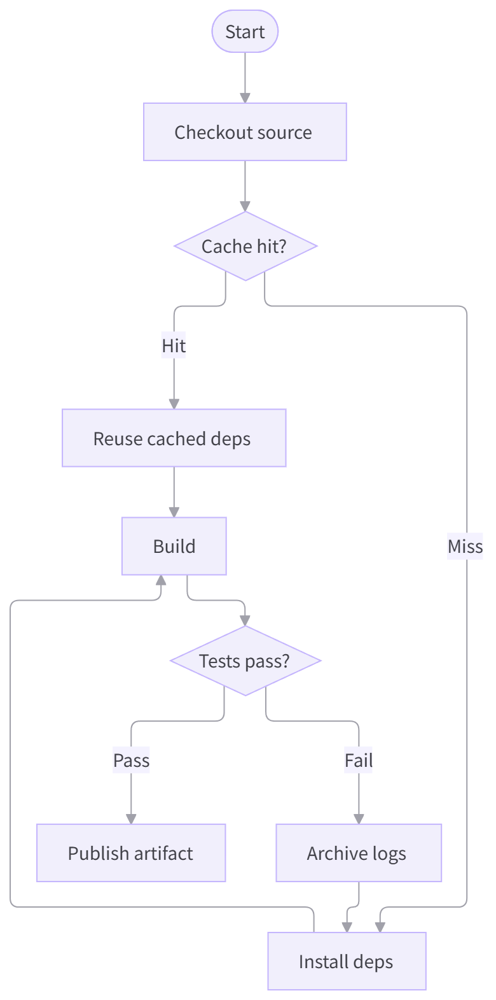
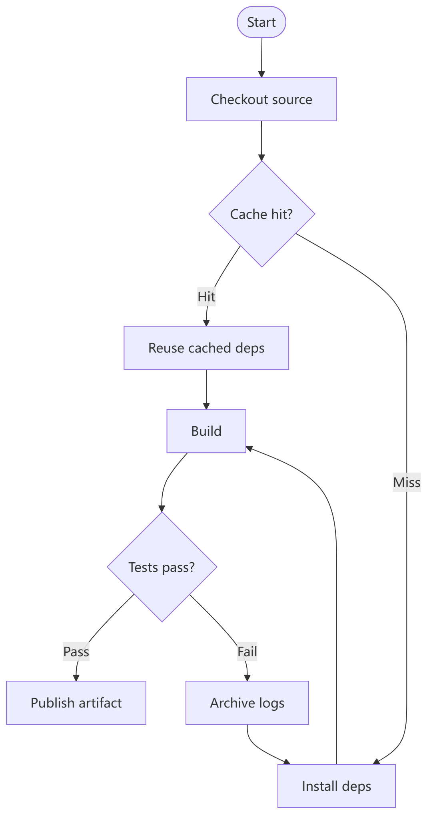
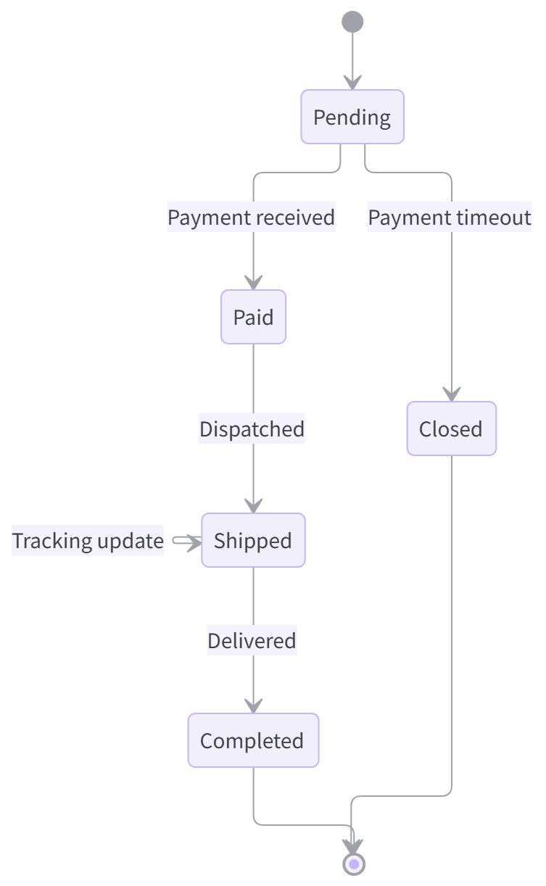
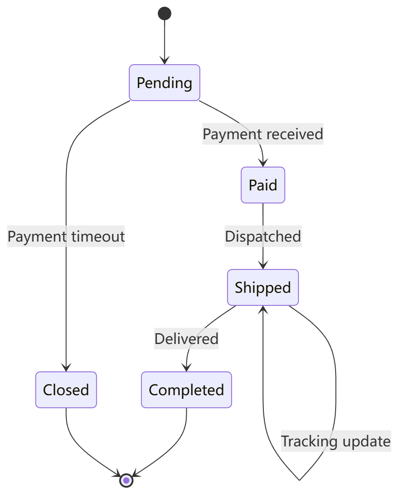
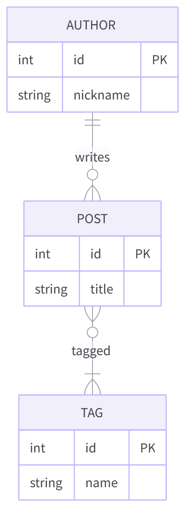
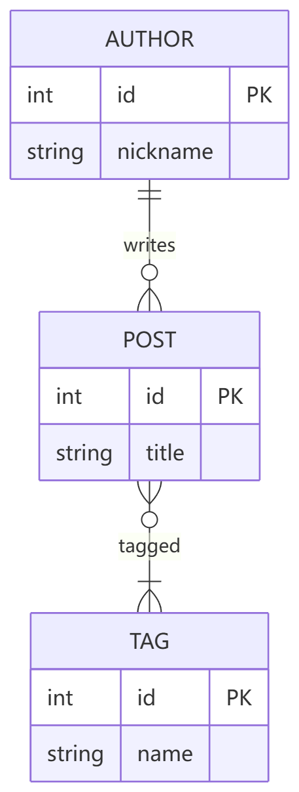
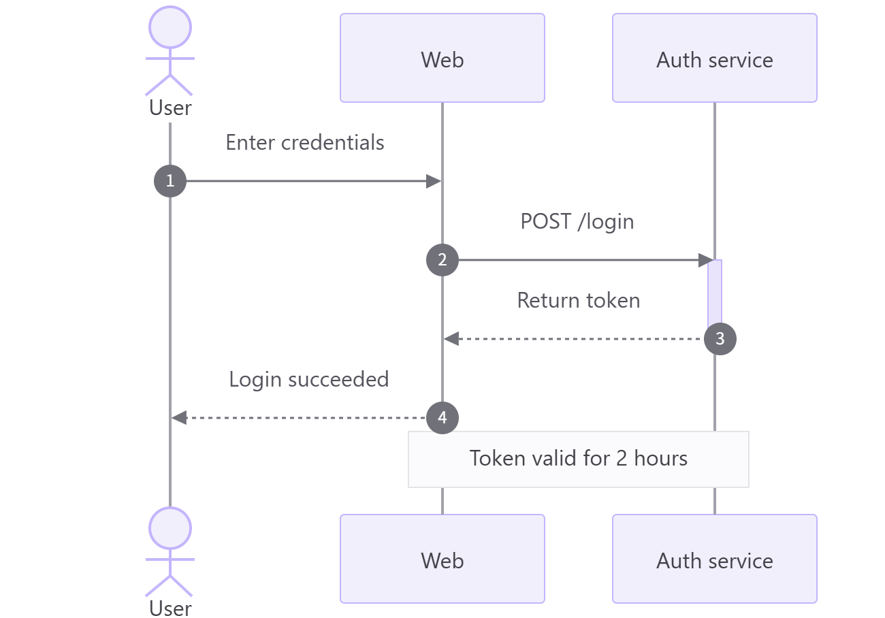
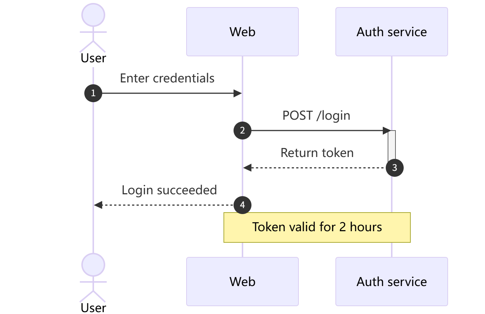
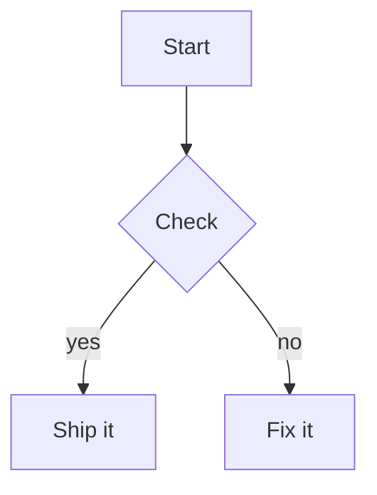
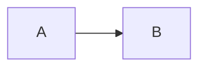

# Clean Mermaid

[](README.md) [](README.zh-CN.md)

Clean Mermaid renders every ` ```mermaid ` block in Obsidian as a tidy card: white canvas, soft
violet nodes, generous whitespace and a floating toolbar — with **ELK layout**, auto-fit, zoom &
pan, expanded view, PNG/SVG export and themable colours.

## Features

- **Every ` ```mermaid ` block is rendered by this plugin** (reading view and live preview) with a
  clean card: centred diagram, auto-fit to the editor width, subtle border, floating controls.
- **ELK layout engine by default** — complex flowcharts get the nicer layered layout. Switch to
  Dagre globally or per diagram when you prefer it.
- **Auto-fit & centre** — diagrams scale with the pane width and are capped to a share of the
  viewport height, so a huge diagram never takes over the note.
- **Zoom & pan** — `Ctrl/Cmd + scroll` zooms around the pointer (10 %–800 %), drag to pan a
  zoomed-in diagram. Plain scrolling still scrolls the note.
- **Image preview** — diagrams are displayed as images, so Obsidian themes and CSS snippets cannot
  restyle them; what you see is what you export.
- **Export** — download a 2× PNG, an SVG, or copy the image / the Mermaid source from the `⋯` menu.
- **Expanded view** (double-click a diagram, or use `⤢` on the card) — opens filling the viewport
  (92 % × 88 %), with the diagram scaled to fit that window (small diagrams get enlarged, up to
  800 %); drag-resizable from any edge or corner, re-fitting the diagram whenever the window changes.
  The toolbar's adaptive-fit button is a **two-state switch** (on / off): while it is on the diagram
  keeps fitting the window, and any manual zoom or pan flips it off so your zoom is never overwritten;
  press `0` or click the button again to turn it back on, and double-click anywhere inside the viewer
  to close it. Pan, wheel/pinch zoom, export.
- **4 built-in themes** — Clean Light, Clean Dark, Neutral, GitHub Light — plus **custom themes**
  as plain Mermaid `themeVariables` JSON, with validation.
- **Light/dark aware** — follows the Obsidian appearance automatically and re-renders on switch.
- **UI language** — the card toolbar, the `⋯` menu, the error card, the expanded viewer and every
  notice follow 中文 / English, or Obsidian's own interface language when set to "Auto".
- **Per-diagram directives** — `%% cm:theme=... %%`, `%% cm:layout=dagre %%`, `%% cm:plain %%`.

## Rendering comparison

Every pair below is the same diagram source. **Left** is this plugin with its factory defaults (ELK
layout, Clean Light theme, card). **Right** is Obsidian's own Mermaid rendering. Both sides are
displayed at the same width; the plugin auto-fits while Obsidian pins flowcharts to the
reading-column width, so absolute pixel size is not part of the claim.

### Flowchart — layout engine

| Clean Mermaid (ELK) | Obsidian native (Dagre) |
| --- | --- |
|  |  |

### State diagram — spacing and edge routing

| Clean Mermaid (ELK) | Obsidian native (Dagre) |
| --- | --- |
|  |  |

### ER diagram — entity boxes

| Clean Mermaid (ELK) | Obsidian native (Dagre) |
| --- | --- |
|  |  |

### Sequence diagram — colours only

ELK does not drive sequence diagrams, so the layout is identical on both sides; only the theme and
typography differ. Kept here so the comparison does not overstate what the layout engine changes.

| Clean Mermaid | Obsidian native |
| --- | --- |
|  |  |

## Installation

1. Download `main.js`, `manifest.json` and `styles.css` from the latest release.
2. Put them into `<your-vault>/.obsidian/plugins/clean-mermaid/`.
3. Enable **Clean Mermaid** in *Settings → Community plugins*.

For building from source, local development and tests, see [CONTRIBUTING.md](CONTRIBUTING.md).

## Usage

Write Mermaid as usual:

````markdown

````

### Interactions

| Action | Gesture |
| --- | --- |
| Zoom | `Ctrl`/`Cmd` + scroll (inline), wheel or pinch (expanded view) |
| Pan | Drag with the left mouse button (when zoomed in) |
| Open expanded | Double-click the diagram, or `⤢` in the card corner |
| Close the expanded view | `Esc`, or double-click anywhere inside the viewer |
| Reset to auto-fit | `Reset zoom` in the `⋯` menu, or click the zoom badge in the corner (the gesture can be given back to double-click in the settings) |
| Menu | `⋯` in the card corner — PNG, SVG, copy image, copy source, reset |

### Directives

Directives must be the first lines of the block and are stripped before rendering:

````markdown

````

| Directive | Effect |
| --- | --- |
| `%% cm:theme=<id> %%` | Use a built-in or custom theme for this diagram only |
| `%% cm:layout=elk\|dagre %%` | Override the layout engine for this diagram only |
| `%% cm:plain %%` | Render this diagram with mermaid's stock look (no card, no toolbar) |

Your own `%%{init: ...}%%` directive always wins over what the plugin injects.

Decision nodes (`A{...}`) are drawn as a diamond sized to their label rather than mermaid's default
**square**. Switch *Settings → Rendering → Decision node shape* back to "mermaid square" if you want
the stock geometry; `%% cm:plain %%` blocks always use it.

## Settings

| Group | Options |
| --- | --- |
| *(no heading, at the top)* | Plugin interface language (card toolbar, `⋯` menu, error card, viewer, notices): follow Obsidian automatically, 中文 or English |
| Appearance | Light/dark theme, follow Obsidian appearance, fixed theme |
| Layout | Layout engine (ELK/Dagre), ELK `mergeEdges`, ELK `nodePlacementStrategy`, auto-fit mode, max upscale, max height |
| Interaction | Ctrl/Cmd + scroll zoom, drag to pan, toolbar visibility, double-click action (open expanded / reset zoom / do nothing) |
| Rendering | Enable Clean Mermaid rendering, render as image, `%% cm: %%` directives, decision node shape (compact diamond / mermaid square) |
| Export | PNG resolution (1×/2×/3×), PNG background (theme/transparent) |
| Custom themes | Add, edit (JSON), delete; invalid JSON is rejected and the last valid version stays |

## Compatibility

- **One mermaid renderer only.** Enable **one** plugin that takes over ` ```mermaid ` blocks.
  If another renderer is detected, Clean Mermaid shows a one-time notice.
- **Scope of the layout engine.** ELK affects diagrams with pluggable layouts (flowchart, state,
  class, ER, …). Sequence, pie, gantt and similar diagrams use their own layout and are unaffected.
- **Desktop only.** Obsidian mobile does not load the plugin; exports always use the browser
  download.
- **Obsidian version.** Requires Obsidian 1.14.4 or newer.
- **Bundled renderer.** The plugin ships its own renderer, so it does not depend on the Mermaid
  version bundled with Obsidian; that makes `main.js` larger than a typical plugin (a few MB).
- **Disabling** the plugin restores Obsidian's own Mermaid rendering and leaves nothing behind.

## Contributing

See [CONTRIBUTING.md](CONTRIBUTING.md) for conventions, build and test commands, and the manual
acceptance checklist.

## License

[MIT](LICENSE) © Clean Mermaid contributors

`main.js` bundles mermaid and its dependencies — their licences are listed in
[THIRD-PARTY-LICENSES.md](THIRD-PARTY-LICENSES.md).

---

中文文档：[README.zh-CN.md](README.zh-CN.md) · 贡献指南：[CONTRIBUTING.zh-CN.md](CONTRIBUTING.zh-CN.md)
