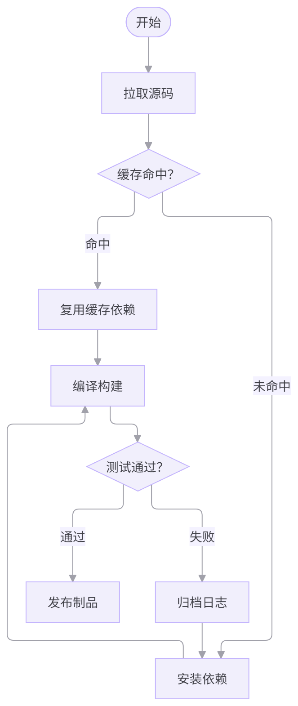
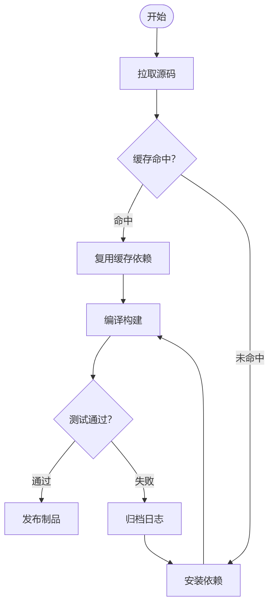
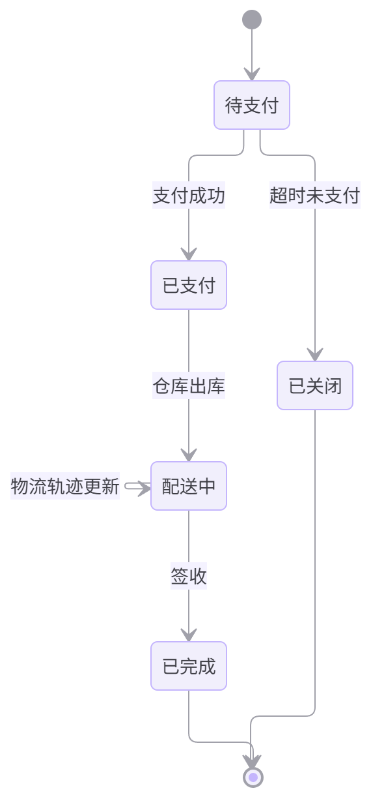
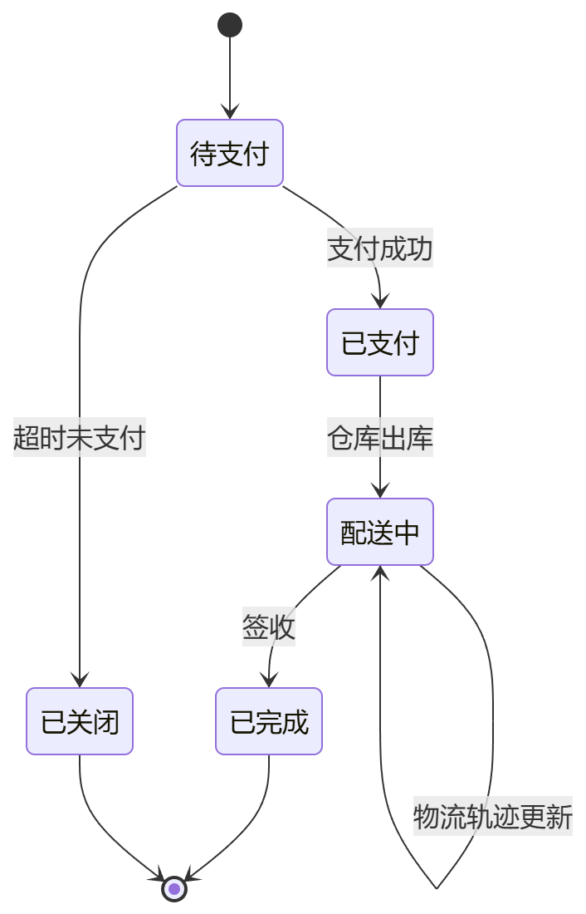
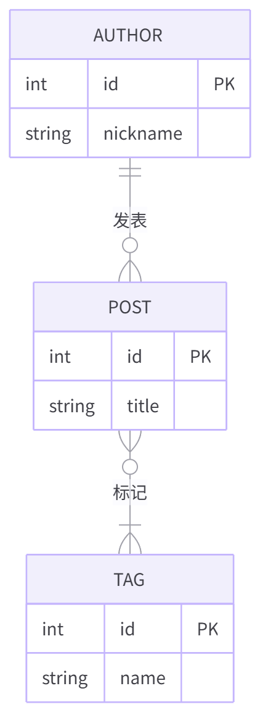
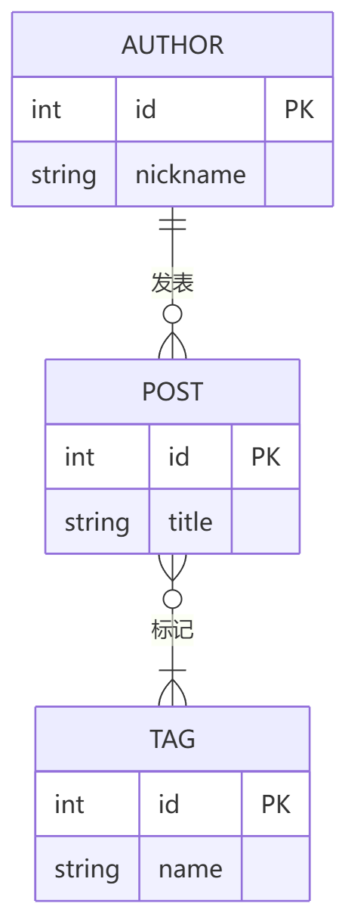
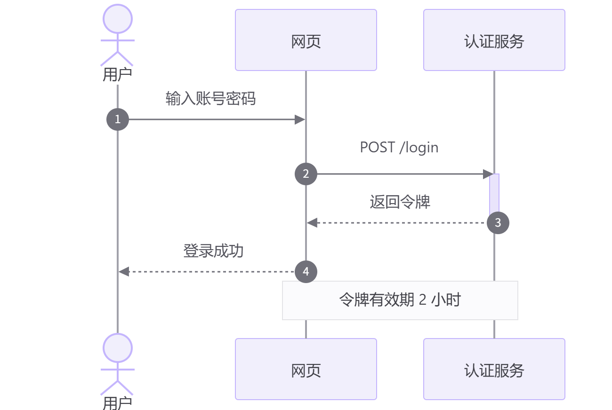
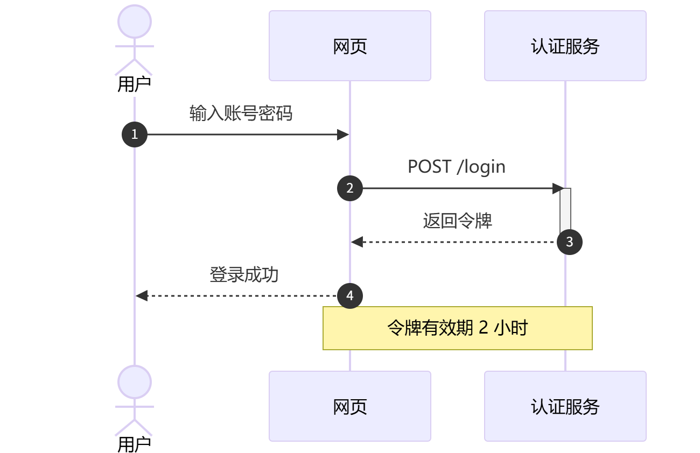
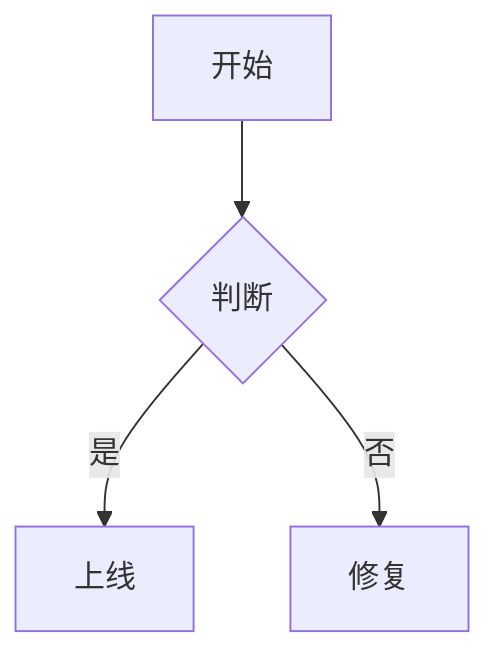
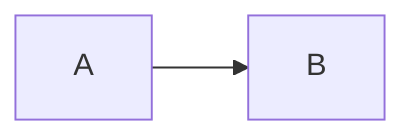

# Clean Mermaid

[](README.md) [](README.zh-CN.md)

Clean Mermaid 把 vault 里每个 ` ```mermaid ` 代码块渲染成一张干净的卡片：白色画布、淡紫节点、
充足留白与悬浮工具条 —— 支持 **ELK 布局**、自适应缩放、缩放与平移、展开查看、PNG/SVG 导出
以及可自定义的主题配色。

## 功能特性

- **所有 ` ```mermaid ` 代码块都由本插件渲染**（阅读视图与实时预览）：居中图表、按编辑器宽度
  自适应、细边框卡片、悬浮控件。
- **默认使用 ELK 布局引擎** —— 复杂流程图能获得更清晰的分层排布；也可在设置中或按图切回 Dagre。
- **自适应与居中** —— 图表随分栏宽度缩放，并受视口高度比例上限约束，超大图表不会占满整篇笔记。
- **缩放与平移** —— `Ctrl/Cmd + 滚轮`以指针为中心缩放（10%–800%），放大后可拖拽平移；
  普通滚轮仍然照常滚动笔记。
- **图片化预览** —— 图表以图片形式显示，Obsidian 主题与 CSS 片段不会改变它的样式，所见即所得。
- **导出** —— 在 `⋯` 菜单中下载 2× PNG、SVG，或复制图片 / 复制 Mermaid 源码。
- **展开查看**（双击图表，或卡片右上角 `⤢`）—— 窗口铺到视口上限打开，图像自动缩放到刚好装进窗口
  （小图会被放大，上限 800%）；四边与四角均可拖拽调整大小，窗口一变图像就重新装填。工具条上的
  自适应按钮是**两态开关**（已开启 / 已关闭）：开启时始终跟着窗口自适应，你一旦手动缩放或平移它就
  自动切到已关闭，缩放不再被覆盖；按 `0` 或再点一次按钮即可重新开启。查看器里双击任意位置直接关闭。
  支持平移、滚轮/双指缩放、导出。
- **4 个内置主题** —— Clean Light、Clean Dark、Neutral、GitHub Light；另支持以标准 Mermaid
  `themeVariables` JSON 编写的**自定义主题**，并带校验。
- **明暗自适应** —— 跟随 Obsidian 外观自动切换，并在切换时即时重绘。
- **界面语言** —— 卡片工具条、`⋯` 菜单、错误卡片、展开查看器与提示等全部文案跟随中文 / English，
  选「自动」时跟随 Obsidian 的界面语言。
- **单图指令** —— `%% cm:theme=... %%`、`%% cm:layout=dagre %%`、`%% cm:plain %%`。

## 渲染对比

下面每一组都是同一份图表源码。**左**侧是本插件的出厂默认（ELK 布局、Clean Light 主题、卡片）；
**右**侧是 Obsidian 自带的 Mermaid 渲染。两侧按同一显示宽度呈现：插件做自适应，Obsidian 则把
流程图锁在阅读列宽度上，所以像素尺寸本身不在对比结论里。

### 流程图 —— 布局引擎

| Clean Mermaid（ELK） | Obsidian 原生（Dagre） |
| --- | --- |
|  |  |

### 状态图 —— 间距与连线走向

| Clean Mermaid（ELK） | Obsidian 原生（Dagre） |
| --- | --- |
|  |  |

### ER 图 —— 实体框

| Clean Mermaid（ELK） | Obsidian 原生（Dagre） |
| --- | --- |
|  |  |

### 时序图 —— 只有配色不同

时序图不由 ELK 驱动，两侧布局完全一致，差别只在主题配色与字体。放进来是为了不把布局引擎的作用说满。

| Clean Mermaid | Obsidian 原生 |
| --- | --- |
|  |  |

## 安装

1. 从最新 Release 下载 `main.js`、`manifest.json`、`styles.css`。
2. 放入 `<你的 Vault>/.obsidian/plugins/clean-mermaid/`。
3. 在 *设置 → 第三方插件* 中启用 **Clean Mermaid**。

从源码构建、本地开发与测试说明见 [CONTRIBUTING.zh-CN.md](CONTRIBUTING.zh-CN.md)。

## 使用

照常编写 Mermaid：

````markdown

````

### 交互

| 操作 | 手势 |
| --- | --- |
| 缩放 | `Ctrl`/`Cmd` + 滚轮（内联），滚轮或双指捏合（展开查看） |
| 平移 | 放大后按住鼠标左键拖动 |
| 展开查看 | 双击图表，或卡片右上角 `⤢` |
| 关闭展开查看 | `Esc`，或在展开窗口里双击任意位置 |
| 复位到自适应 | `⋯` 菜单中的「重置缩放」，或点右下角的缩放百分比徽标（双击可改回复位，见设置） |
| 菜单 | 卡片右上角 `⋯` —— PNG、SVG、复制图片、复制源码、重置缩放 |

### 指令

指令需写在代码块最前面，渲染前会被剥离：

````markdown

````

| 指令 | 作用 |
| --- | --- |
| `%% cm:theme=<id> %%` | 仅本图使用指定内置或自定义主题 |
| `%% cm:layout=elk\|dagre %%` | 仅本图覆盖布局引擎 |
| `%% cm:plain %%` | 本图按 mermaid 原生外观渲染（无卡片、无工具条） |

你自己写的 `%%{init: ...}%%` 指令优先级始终高于插件注入的配置。

判断节点（`A{...}`）默认画成贴着文字的菱形，而不是 mermaid 原生的正方形；想找回原生画法，切到
*设置 → 渲染 → 判断节点形状*选「mermaid 正方形」，`%% cm:plain %%` 块恒用原生画法。

## 设置

| 分组 | 选项 |
| --- | --- |
| *（置顶，无分组标题）* | 插件界面语言（卡片工具条、`⋯` 菜单、错误卡片、展开查看器与提示）：自动跟随 Obsidian、中文或 English |
| 外观 | 浅色/深色主题、跟随 Obsidian 明暗、固定主题 |
| 布局 | 布局引擎（ELK/Dagre）、ELK `mergeEdges`、ELK `nodePlacementStrategy`、自适应方式、最大放大倍率、最大高度 |
| 交互 | Ctrl/Cmd + 滚轮缩放、拖拽平移、工具条显示方式、双击操作（展开查看 / 复位缩放 / 不响应） |
| 渲染 | 启用 Clean Mermaid 渲染、图片化渲染、`%% cm: %%` 指令支持、判断节点形状（紧凑菱形 / mermaid 正方形） |
| 导出 | PNG 分辨率（1×/2×/3×）、PNG 背景（主题/透明） |
| 自定义主题 | 新增、编辑（JSON）、删除；非法 JSON 会被拒绝并保留上一版生效值 |

## 兼容性

- **只启用一个 mermaid 渲染插件。** 请只启用**一个**接管 ` ```mermaid ` 块的插件；若检测到其它
  渲染器，Clean Mermaid 会给出一次提示。
- **布局引擎的范围。** ELK 影响支持可插拔布局的图型（flowchart、state、class、ER 等）；时序图、
  饼图、甘特图等使用自有布局，不受影响。
- **仅桌面。** Obsidian 移动端不会加载本插件；导出一律走浏览器下载。
- **Obsidian 版本。** 需要 Obsidian 1.14.4 或更高版本。
- **自带渲染引擎。** 不依赖 Obsidian 内置的 Mermaid 版本，因此 `main.js` 比一般插件大（数 MB）。
- **禁用插件**后图表恢复为 Obsidian 自带的 Mermaid 渲染，不会留下任何改动。

## 参与贡献

协作规范、构建与测试命令、手动验收清单见 [CONTRIBUTING.zh-CN.md](CONTRIBUTING.zh-CN.md)。

## 许可证

[MIT](LICENSE) © Clean Mermaid contributors

`main.js` 打包了 mermaid 及其依赖，它们的许可见
[THIRD-PARTY-LICENSES.md](THIRD-PARTY-LICENSES.md)。

---

English docs: [README.md](README.md) · [CONTRIBUTING.md](CONTRIBUTING.md)
